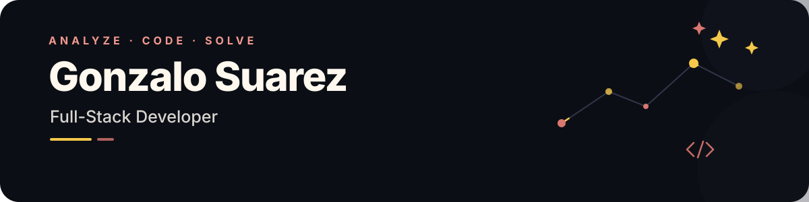

  

  
  &nbsp;&nbsp;
  
  &nbsp;&nbsp;
  

##

💻 I'm a Full Stack programming student at UTN (National Technological University) in Buenos Aires.

 - ⭐ Currently focused on Python</li>
 - ⭐ Passionate about developing innovative solutions</li>
 - ⭐ Dedicated to continuous learning and improvement</li>
  

  
  
  
  
  
  
  
  
  

